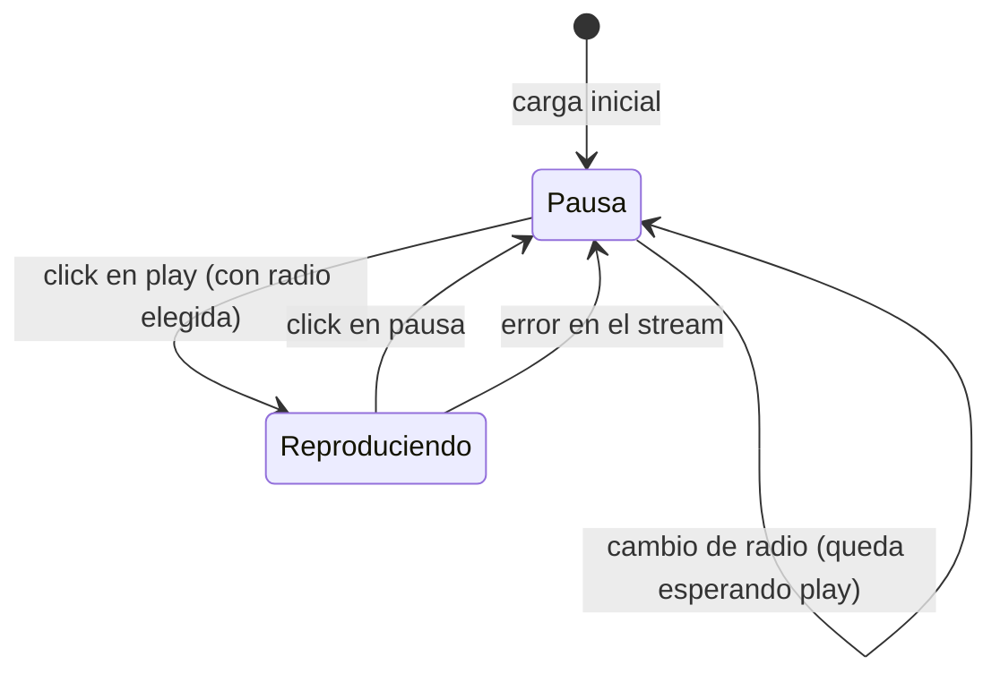
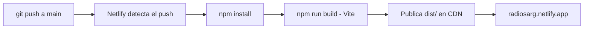

# 🏗️ Arquitectura — Radios Argentinas

Este documento describe la arquitectura de la aplicación, las decisiones técnicas tomadas y cómo evolucionó el proyecto. Está pensado para que cualquier persona pueda entender qué hace cada pieza y por qué está donde está.

## Índice

1. [Visión general](#-visión-general)
2. [Stack y decisiones técnicas](#-stack-y-decisiones-técnicas)
3. [Estructura del proyecto](#-estructura-del-proyecto)
4. [Flujo de datos](#-flujo-de-datos)
5. [Máquina de estados del reproductor](#-máquina-de-estados-del-reproductor)
6. [Pipeline de deploy](#-pipeline-de-deploy)
7. [Evolución planificada](#-evolución-planificada)

---

## 🔭 Visión general

Radios Argentinas es una **aplicación web estática de una sola página** para escuchar radios argentinas en vivo. No tiene backend propio: la lista de emisoras se sirve como archivo estático y el audio se transmite directo desde los CDN de cada radio (StreamTheWorld, MDStrm, ICEcast, etc.).

```
┌─────────────────────────── Navegador ───────────────────────────┐
│                                                                  │
│   index.html ──► src/index.js ──► <audio> (elemento oculto)      │
│       │                  │                    │                  │
│   src/style.css     fetch /radios.json         │                  │
│                           │                    │                  │
└───────────────────────────┼────────────────────┼──────────────────┘
                            ▼                    ▼
                    CDN estático (Netlify)   CDN de streaming de cada radio
```

**Características del sistema:**

- **100% estática**: se puede alojar en cualquier CDN, no requiere servidor de aplicaciones.
- **Sin base de datos**: el "catálogo" de radios es un JSON versionado en el repo.
- **Streaming directo**: el navegador reproduce los streams vía el elemento `<audio>` nativo; la app nunca toca los bytes de audio.

## 🧰 Stack y decisiones técnicas

| Decisión | Alternativa descartada | Motivo |
|---|---|---|
| JavaScript vanilla sin framework | React / Vue / Svelte | La UI tiene 4 elementos interactivos; un framework agregaría peso de runtime sin beneficio real. |
| Vite como bundler | Webpack, CRA | Configuración cero, dev server rápido y build optimizado por defecto. |
| `radios.json` en `/public` | Constante en el JS | Desacopla el catálogo del código: se agregan radios sin tocar la lógica. |
| Elemento `<audio>` nativo | Librerías de player (HLS.js, Howler) | Los streams usados son AAC/MP3/ICEcast, reproducibles nativamente; HLS.js solo sería necesario si se adoptaran streams HLS con manifiesto `.m3u8`. |
| Netlify | Vercel, GitHub Pages | Deploy automático desde `main`, dominio propio, SSL y CDN global sin costo. |

## 📂 Estructura del proyecto

```
radios-argentinas/
├── public/                  # Archivos servidos tal cual, sin procesar
│   ├── radios.json          # Catálogo de radios (única fuente de verdad)
│   └── mic.png              # Favicon
├── src/
│   ├── index.js             # Toda la lógica: carga de radios, player, fecha
│   ├── style.css            # Estilos globales
│   └── assets/images/       # Íconos play/pause y fondo (bandera argentina)
├── index.html               # Página única (shell de la aplicación)
├── netlify.toml             # Configuración de build para Netlify
├── ARCHITECTURE.md          # Este documento
└── package.json             # Scripts y dependencias de desarrollo
```

### Responsabilidades por archivo

| Archivo | Responsabilidad |
|---|---|
| `index.html` | Estructura semántica: reproductor (botón, volumen, selector) y footer. |
| `src/index.js` | 1) Cargar `radios.json` y poblar el `<select>`. 2) Gestionar reproducción, volumen y cambios de radio. 3) Mostrar la fecha actual. |
| `src/style.css` | Fondo con overlay, estilos del selector, footer y estados hover. |
| `public/radios.json` | Catálogo de emisoras: `key`, `name`, `url`. |

## 🔄 Flujo de datos

```mermaid
sequenceDiagram
    participant U as Usuario
    participant JS as src/index.js
    participant CDN as Netlify (estático)
    participant ST as Stream de la radio

    U->>JS: Carga de la página
    JS->>CDN: GET /radios.json
    CDN-->>JS: Array de radios
    JS->>U: Popula el <select> con las emisoras
    U->>JS: Elige una radio
    U->>JS: Click en play
    JS->>ST: audioElement.play() contra la URL del stream
    ST-->>JS: Stream de audio en vivo (continuo)
    U->>JS: Ajusta volumen / cambia de radio / pausa
```



**Puntos clave:**

- La lista de radios se carga **una vez** al iniciar (sin caché adicional; es un archivo de ~2 KB).
- El audio **nunca pasa por la app**: el `<audio>` se conecta directo al CDN de la radio, así que el consumo de ancho de banda del sitio es despreciable.
- Cambiar de radio solo reasigna `src` del `<audio>`; no hay peticiones intermedias.

## 🎛️ Máquina de estados del reproductor

El reproductor tiene un estado simple con dos valores (`isPlaying`):



**Reglas del estado:**

- Si no hay radio seleccionada, el botón play **no** altera el estado (evita el bug de doble click).
- Al cambiar de radio estando en reproducción, la nueva emisora **arranca automáticamente**.
- Si el stream falla (radio caída, corte de red), el reproductor vuelve a pausa y lo registra en consola.

## 🚢 Pipeline de deploy



- Configuración: [`netlify.toml`](netlify.toml) define `command` y `publish`.
- Cada push a `main` genera un deploy; los Pull Requests generan previews automáticos.

## 🧭 Evolución planificada

El proyecto está en proceso de migración hacia **Astro 5 + isla de React**. El objetivo de la nueva arquitectura:

- **Astro** para el shell estático (SEO, carga instantánea, HTML en el servidor de build).
- **Isla de React** para el reproductor: el único componente interactivo, hidratado con `client:load`.
- **PWA completa**: instalable en el celular, service worker para la UI offline y **Media Session API** para controles de reproducción en la pantalla de bloque.
- **Assets optimizados**: íconos SVG inline (en lugar de PNG), fondo en WebP, slider de volumen con estilos propios y diseño responsive del footer.

Los detalles de la arquitectura objetivo se documentan en la sección *Migración a Astro* una vez completada la Fase 2.
