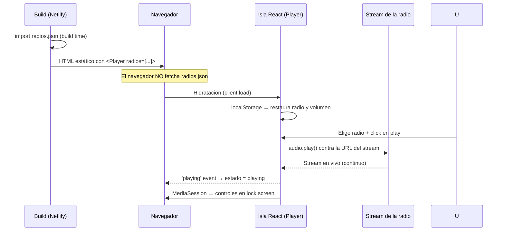
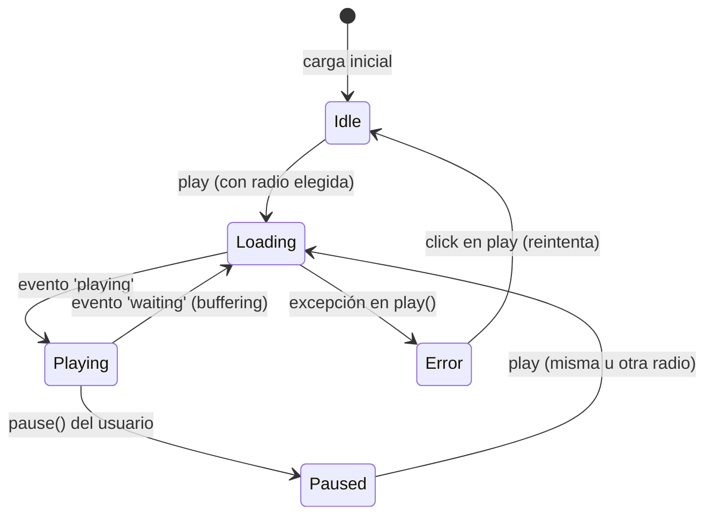
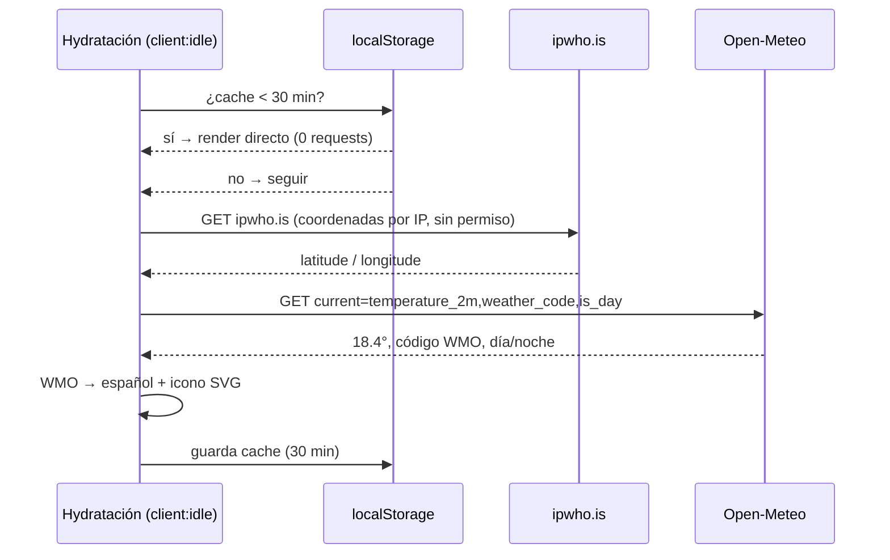
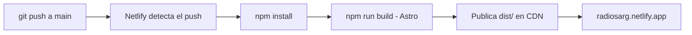

# 🏗️ Arquitectura — Radios Argentinas

Este documento describe la arquitectura de la aplicación, las decisiones técnicas tomadas y cómo evolucionó el proyecto. Está pensado para que cualquier persona pueda entender qué hace cada pieza y por qué está donde está.

## Índice

1. [Visión general](#-visión-general)
2. [Stack y decisiones técnicas](#-stack-y-decisiones-técnicas)
3. [Estructura del proyecto](#-estructura-del-proyecto)
4. [Flujo de datos](#-flujo-de-datos)
5. [Máquina de estados del reproductor](#-máquina-de-estados-del-reproductor)
7. [Arquitectura PWA](#-arquitectura-pwa)
8. [Almanaque (fecha + clima)](#️-almanaque-fecha--clima-automático)
9. [Pipeline de deploy](#-pipeline-de-deploy)
10. [Historial de arquitectura](#-historial-de-arquitectura)

---

## 🔭 Visión general

Radios Argentinas es una **aplicación web estática de una sola página** para escuchar radios argentinas en vivo, instalable como PWA. No tiene backend propio: el catálogo de emisoras se resuelve en build time y el audio se transmite directo desde los CDN de cada radio (StreamTheWorld, MDStrm, ICEcast, etc.).

```
┌───────────────────────────── Navegador ─────────────────────────────┐
│                                                                      │
│  HTML estático (Astro)                                               │
│      │                                                               │
│      ├─► Isla React <Player> ──► useAudio ──► <audio> oculto         │
│      │        (radios via props, sin fetch)          │               │
│      └─► Service Worker (app shell offline)          │               │
│                                                      │               │
└──────────────────────────────────────────────────────┼───────────────┘
                                                       ▼
                                        CDN de streaming de cada radio
```

**Características del sistema:**

- **100% estática**: se aloja en cualquier CDN, no requiere servidor de aplicaciones.
- **Sin base de datos**: el "catálogo" de radios es un JSON versionado en el repo, importado en build time (el navegador nunca lo descarga por separado).
- **Streaming directo**: el navegador reproduce los streams vía el elemento `<audio>` nativo; la app nunca toca los bytes de audio.
- **PWA**: instalable, con controles de reproducción en pantalla de bloque.
- **Almanaque**: fecha + clima automático sin prompts (IP → Open-Meteo), con degradación silenciosa.
- **Dark mode único**: sin imágenes de fondo; la identidad se construye con tipografía, glow celeste y glass sutil.

## 🧰 Stack y decisiones técnicas

| Decisión | Alternativa descartada | Motivo |
|---|---|---|
| Astro para el shell estático | SPA (React/Vue "bare") | La página es contenido estático: Astro la genera en build time con SEO perfecto y cero JS innecesario. |
| Isla de React solo para el player | Todo el sitio en React | El único componente con estado real es el reproductor. `client:load` hidrata solo esa pieza; el resto es HTML puro. |
| Radios importadas en build time (`import radios from '../data/radios.json'`) | `fetch` en runtime | Cero requests, cero flash de contenido vacío. Agregar una radio = editar JSON + push (el deploy reconstruye). |
| Eventos del `<audio>` como fuente de verdad | Estado invertido a mano (`isPlaying = !isPlaying`) | Elimina bugs de estados desincronizados (ej.: doble click necesario para reproducir). |
| Elemento `<audio>` nativo | Librerías de player (HLS.js, Howler) | Los streams usados son AAC/MP3/ICEcast, reproducibles nativamente; HLS.js solo sería necesario con manifiestos `.m3u8`. |
| SVG inline para íconos | PNGs (`play.png`, `pause.png`) | Se recolorean con CSS, escalan sin blur y ahorran 2 requests. |
| Workbox (vía `@vite-pwa/astro`) en modo `generateSW` | Service worker escrito a mano | Configuración declarativa, precache automático del app shell con hash de versiones. |
| Netlify | Vercel, GitHub Pages | Deploy automático desde `main`, dominio propio, SSL y CDN global sin costo. |
| Vite (directo) | — | Reemplazado por Astro 5, que internamente usa Vite y además resuelve el render estático y las islas. |
| Tailwind v4 (`@tailwindcss/vite`) | CSS plano con clases BEM | Estilos co-localizados en cada componente, tokens centralizados en `@theme`, CSS final tree-shakeado (12.6 KB con todo el sitio). La integración `@astrojs/tailwind` está deprecada: v4 se integra como plugin de Vite. |
| Clima: Open-Meteo + ubicación por IP (ipwho.is) | API con key / GPS del navegador | Sin backend no hay dónde guardar una API key de forma segura (quedaría expuesta en el cliente); el GPS nativo **siempre** muestra un prompt de permiso. Ambos servicios son gratis, sin key y con HTTPS. |
| Capa custom mínima en `global.css` | Todo en utilidades | Solo lo no expresable: fondo con glow radial (`bg-app`), flecha del select (`select-arrow`) y pseudo-elementos del slider (`.range-field`). |

## 📂 Estructura del proyecto

```
radios-argentinas/
├── public/                  # Archivos servidos tal cual (sin procesar)
│   ├── favicon.svg          # Favicon vectorial
│   └── icons/               # Íconos PWA (192/512) y apple-touch-icon
├── src/
│   ├── data/radios.json     # Catálogo: única fuente de verdad de emisoras
│   ├── hooks/
│   │   ├── useAudio.js      # Máquina de estados + elemento <audio>
│   │   ├── useMediaSession.js  # Controles del sistema operativo
│   │   └── useAlmanac.js    # Fecha + clima automático (IP → Open-Meteo)
│   ├── components/          # Islas de React
│   │   ├── Player.jsx       # Orquestador (estado, persistencia, datos)
│   │   ├── PlayButton.jsx   # Botón central (SVG: play/pause/spinner)
│   │   ├── VolumeSlider.jsx # Volumen con % visible
│   │   ├── RadioSelector.jsx# <select> de emisoras
│   │   ├── Almanac.jsx      # Pill de fecha/clima (client:idle)
│   │   └── WeatherIcon.jsx  # SVGs del clima (código WMO → icono)
│   ├── layouts/BaseLayout.astro  # <head> (SEO/OG/PWA), footer, fecha
│   ├── pages/index.astro    # Página única, HTML estático
│   └── styles/global.css    # Tokens @theme, utilidades custom, foco global
├── astro.config.mjs         # Integraciones: react, PWA (manifest, SW), Tailwind
├── netlify.toml             # command + publish para Netlify
├── ARCHITECTURE.md          # Este documento
└── package.json
```

### Responsabilidades por archivo

| Archivo | Responsabilidad |
|---|---|
| `src/pages/index.astro` | Genera el HTML estático; importa el catálogo y lo pasa como prop a la isla. |
| `src/layouts/BaseLayout.astro` | SEO, Open Graph, favicon, manifest, registro del SW, footer y fecha actual. |
| `src/components/Player.jsx` | Orquesta la isla: sincroniza estado, restaura/guarda preferencias, arma el mensaje de estado. |
| `src/hooks/useAudio.js` | Ciclo de vida del `<audio>` y estados `idle/loading/playing/paused/error` derivados de eventos reales. |
| `src/hooks/useMediaSession.js` | Metadatos y handlers play/pause para la pantalla de bloque y auriculares. |
| `src/hooks/useAlmanac.js` | Fecha local + clima: cache 30 min → ipwho.is (coordenadas por IP) → Open-Meteo (clima). Falla silenciosa: sin datos muestra solo la fecha. |
| `src/data/radios.json` | Catálogo de emisoras: `id`, `name`, `dial`, `location`, `genre`, `streamUrl`, `homepage`. |
| `src/styles/global.css` | Tokens Tailwind (`@theme`), `color-scheme: dark`, foco de teclado global y utilidades custom (`bg-app`, `select-arrow`, thumb del slider). |
| `astro.config.mjs` | Integraciones React/PWA y plugin de Vite de Tailwind. |

## 🔄 Flujo de datos



**Puntos clave:**

- El catálogo **viaja embebido** en el HTML: la isla lo recibe como prop serializada.
- El audio **nunca pasa por la app**: el `<audio>` se conecta directo al CDN de la radio, así que el consumo de ancho de banda del sitio es despreciable.
- Cambiar de radio solo reasigna `src` del `<audio>`; no hay peticiones intermedias.
- Preferencias (`ra:radio`, `ra:volume` en `localStorage`) se restauran post-hidratación para evitar mismatches con el HTML server-rendered.

## 🎛️ Máquina de estados del reproductor

El hook `useAudio` deriva el estado de los **eventos reales** del elemento `<audio>`:



**Reglas:**

- Sin radio elegida el botón está **deshabilitado** (no existe el "estado invertido sin nada sonando").
- `loading` es explícito: el botón muestra un **spinner** mientras conecta.
- Si el stream falla, el estado pasa a `error`, el botón se pinta con borde rojo y la línea de estado avisa; `click` reintenta.
- **Intención vs realidad**: `useAudio` mantiene `wantPlayingRef` (la radio "prendida/apagada") separado del estado real. `select(url)` — el método que usa el selector al cambiar de emisora — honra la intención: si estaba prendida, la nueva emisora arranca sola (girar el dial no pausa, cambia). Si el stream estaba en error y se cambia de radio, se reintenta solo.
- **Dial = sintonía, botón = encendido**: el dial del botón refleja la emisora elegida (posición proporcional en la escala; marca dorada de OFF cuando no hay emisora) y solo gira cuando cambia el selector — un cambio real de radio. El ícono muestra el estado real: ⏸ mientras suena, ▶ en pausa o apagado. Pausar no re-sintoniza; prender no re-sintoniza.
- **HLS (streams `.m3u8`)**: el `<audio>` nativo no los reproduce (salvo Safari). `useAudio` importa **hls.js en diferido** (`await import('hls.js')`) solo al elegir una emisora HLS — el resto del catálogo jamás descarga el chunk. Errores fatales de hls.js van al estado `error` (los recuperables los resuelve la librería); al pausar se corta la descarga de segmentos (`stopLoad`) y al cambiar de emisora o desmontar se destruye la instancia (si no, fuga de memoria).
- El `service worker` no interfiere con los streams: son cross-origin y Workbox solo maneja sus rutas registradas.

## 📡 Arquitectura PWA

Configurada íntegramente en [`astro.config.mjs`](astro.config.mjs) vía `@vite-pwa/astro`:

| Pieza | Archivo | Rol |
|---|---|---|
| Manifest | `dist/manifest.webmanifest` (generado) | Nombre, íconos, colores, `display: standalone` → instalable |
| Service Worker | `dist/sw.js` (generado, modo `generateSW`) | Precache del app shell: la UI carga incluso sin conexión |
| Registro | `dist/registerSW.js` (referenciado en `BaseLayout`) | `autoUpdate`: la próxima visita toma la versión nueva |
| Íconos | `public/icons/icon-{192,512}.png` | Instalación en Android/desktop; `apple-touch-icon` para iOS |
| Media Session | `useMediaSession.js` | Controles y metadatos en la pantalla de bloque |

**Qué se cachea y qué no:**

- ✅ Precache: HTML, CSS, JS, SVG, PNG del app shell (~286 KB).
- ❌ Streams de radio: en vivo y cross-origin, pasan directo a la red (Workbox solo intercepta sus rutas registradas).
- ℹ️ La lista de radios no se cachea por separado: va embebida en el HTML, que sí está precacheado.

> **Nota de implementación:** `@vite-pwa/astro` genera `manifest.webmanifest` y `registerSW.js` pero no los inyecta en el HTML producido por Astro; por eso `BaseLayout.astro` los referencia manualmente (`<link rel="manifest">` + `<script src="/registerSW.js">`).

## 🌦️ Almanaque (fecha + clima automático)

El footer muestra una pill con la fecha del día y el clima actual. El requisito clave: **cero prompts y cero interacción del usuario**, lo que descarta la API de geolocalización nativa (siempre pide permiso). El flujo completo corre en el cliente:



**Decisiones:**

- **Open-Meteo** y **ipwho.is** son gratis, **sin API key** y con HTTPS: no hay secretos en el cliente ni backend propio.
- El código WMO se traduce a español (`WMO_CONDITIONS` en `useAlmanac.js`) y a íconos SVG de trazo (`WeatherIcon.jsx`), con variante nocturna ("Despejado" + luna).
- **Fallo silencioso**: si el IP-geo o el clima fallan, la pill muestra solo la fecha. Nunca hay errores visibles ni bloqueos.
- **Cache 30 min** en `ra:almanac` (localStorage): recargas no regeneran requests; las APIs tienen límites gratuitos generosos.
- Privacidad: ipwho.is ve la IP del visitante (es como funciona toda geo-por-IP); no se muestra la ciudad, solo se usan las coordenadas.
- El SW no interfiere: ambas APIs son cross-origin sin rutas registradas (pasa directo a red); offline el almanaque simplemente queda sin clima.

## 🚢 Pipeline de deploy



- Configuración: [`netlify.toml`](netlify.toml) define `command` y `publish`.
- Cada push a `main` genera un deploy; los Pull Requests generan previews automáticos.

## 📜 Historial de arquitectura

| Versión | Stack | Cambios |
|---|---|---|
| v1 | HTML + CSS + JS vanilla, Vite, Netlify | App funcional básica. Bugs de estado en el player, sin SEO, deploy mal configurado. |
| v1.5 | v1 + fixes | Estado del player corregido, meta tags, `netlify.toml` arreglado, JSDoc completo. Ver commit `fix:` en el historial. |
| v2 | Astro 5 + isla de React + PWA | Render estático con SEO, máquina de estados por eventos, catálogo en build time, PWA instalable con Media Session, assets optimizados (SVG inline). |
| v2.1 | + Tailwind v4 | Migración completa de estilos a utilidades: tokens en `@theme`, capa custom reducida a lo no expresable (fondo, flecha del select, thumb del slider). CSS final tree-shakeado. |
| **v3 (actual)** | + Almanaque + UI dark celeste | Almanaque de fecha y clima automático (IP → Open-Meteo, sin prompts, cache 30 min). Rediseño: dark mode único con glow radial celeste, slider con relleno dinámico, select glass oscuro (`color-scheme: dark`), sin imágenes de fondo (se elimina el WebP, precache -30%). |
